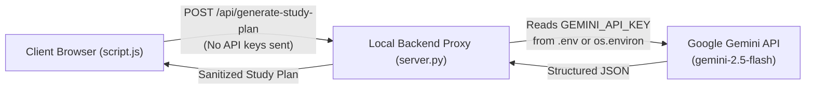

# StudySync &mdash; Smart Student Planner & AI Study Assistant

> A modern, responsive, and beginner-friendly web application designed for Computer Science and Data Science students to organize coursework, track deadlines, highlight overdue assignments, and generate customized, prioritized study roadmaps using an **AI Study Assistant**. Built with Vanilla HTML5, CSS3, JavaScript, a secure Python backend proxy, and browser `localStorage`.

---

## 📖 Table of Contents
1. [Project Overview](#project-overview)
2. [Key Features](#key-features)
3. [AI Study Assistant & Architecture](#ai-study-assistant--architecture)
4. [Secure API Key Configuration Guide](#secure-api-key-configuration-guide)
5. [Technology Stack](#technology-stack)
6. [File & Directory Structure](#file--directory-structure)
7. [How to Run the Project](#how-to-run-the-project)
8. [How Browser `localStorage` Works](#how-browser-localstorage-works)
9. [JavaScript Architecture & Core Functions](#javascript-architecture--core-functions)
10. [Manual Test Cases & Verification Matrix](#manual-test-cases--verification-matrix)
11. [Automated Test Suite (42 Tests)](#automated-test-suite-42-tests)
12. [Known Limitations & Future Roadmap](#known-limitations--future-roadmap)

---

## 🎯 Project Overview

As a Computer Science or Data Science student, balancing coding assignments, math problem sets, database labs, and exam revision across multiple courses can quickly become overwhelming.

**StudySync** solves this challenge through two connected modules:
1. **The Task Planner**: A distraction-free dashboard with real-time statistics, automated overdue detection, visual priority ribbons, and instant filtering.
2. **The AI Study Assistant**: An intelligent study coach that takes a student's topic, available time budget, and difficulty level to produce an actionable, time-blocked study roadmap, a plain-English conceptual explanation, and 5 self-check practice questions.

---

## ✨ Key Features

### 1. Task Planner & Semester Dashboard
- **Full CRUD Management**: Create, read, complete, and delete coursework tasks.
- **Automated Overdue Detection**: Compares target due dates against local midnight. Uncompleted overdue tasks are visually highlighted with warning borders, background tinting, and `⚠️ Overdue by X days` badges.
- **Semester Statistics & Progress Bar**: Real-time overview counters (**Total**, **Pending**, **Completed**, and **Overdue**) with animated percentage progress.
- **Instant Search & Multi-Criteria Filtering**: Filter by status (`All`, `Pending`, `Completed`) and perform instant keystroke searches across titles and course tags.
- **Sorting Options**: Sort by due date (earliest/latest), priority weight (High &rarr; Medium &rarr; Low), or alphabetical title.
- **Client-Side Persistence (`localStorage`)**: Retains all tasks, checkboxes, and counters across browser refreshes with zero cloud tracking.

### 2. AI Study Assistant Module
- **Customized Inputs**:
  - **Topic or Subject**: Free-form text input with quick suggestion chips (`Binary Search Trees`, `Dijkstra's Algorithm`, `SQL Joins`, `Linear Regression`, `Integration by Parts`).
  - **Available Study Time**: Flexible minute duration (10 to 300 minutes) with one-click duration pills (`15m`, `30m`, `45m`, `60m`, `90m`).
  - **Difficulty Level**: `Beginner` (Foundations & Intuition), `Intermediate` (Mechanics & Edge Cases), or `Advanced` (Proofs, Complexity & Optimization).
- **Generated Outputs**:
  - **Plain-English Explanation**: Core concept breakdown, real-world intuitive analogy, and key takeaway bullets.
  - **Prioritized Study Plan**: Time-blocked phases summing up exactly to the student's available study time, each tagged with a priority level (`High`, `Medium`, `Low`), specific focus objective, and actionable checklist tasks.
  - **Five Practice Questions**: Self-check diagnostic questions featuring interactive **"Reveal Answer & Explanation"** toggles.
  - **Direct Task Planner Import**: An **"Add Milestones to Planner"** button that automatically converts the generated study plan phases into scheduled planner tasks.

---

## 🤖 AI Study Assistant & Architecture

### Security First: Never Expose API Keys in Frontend Code
StudySync strictly follows software engineering security best practices:
- **No API Keys in the Browser**: API keys are never stored in HTML, CSS, or JavaScript files where they could be inspected via browser DevTools.
- **Backend Proxy (`server.py`)**: All AI requests are mediated through a lightweight Python server. The backend securely reads the `GEMINI_API_KEY` from the system environment or a private `.env` file, sends the request to Google's Gemini REST API, and returns sanitized JSON to the browser.



### Transparent Modes (No Fake AI Claims)
- **Live AI Mode**: When `GEMINI_API_KEY` is configured, StudySync uses Google Gemini to generate dynamic, real-time responses. A badge displays `🟢 Live Generative AI (Google Gemini)`.
- **Demo Curriculum Mode**: When no API key is provided, StudySync clearly displays `🟡 Demo Curriculum Mode (No API key set)`. It serves high-quality, verified student curriculum templates without pretending that the responses are generated by live machine learning models.

---

## 🔑 Secure API Key Configuration Guide

To enable live Google Gemini Generative AI:

### Step 1: Obtain a Free Gemini API Key
1. Go to [Google AI Studio](https://aistudio.google.com/app/apikey).
2. Sign in with your Google account and click **"Create API Key"**.
3. Copy your generated key (e.g., `AIzaSy...`).

### Step 2: Configure the Key on Your Computer

#### Option A: Using a `.env` file (Recommended)
1. In your `studysync` project directory, make a copy of [`.env.example`](file:///C:/Users/aayus/.gemini/antigravity/scratch/studysync/.env.example) and name it `.env`:
   ```bash
   cp .env.example .env
   ```
2. Open `.env` and paste your key:
   ```ini
   GEMINI_API_KEY=AIzaSyYourActualSecretKeyHere
   ```
*(Note: `.env` is listed in [`.gitignore`](file:///C:/Users/aayus/.gemini/antigravity/scratch/studysync/.gitignore) so your key is never accidentally committed).*

#### Option B: Using Windows PowerShell Environment Variable
```powershell
$env:GEMINI_API_KEY="AIzaSyYourActualSecretKeyHere"
```

### Step 3: Start the Backend Server
```powershell
python server.py
```
The server will log:
```text
[AI Mode]: LIVE (Google Gemini API key detected securely on backend)
```

---

## 🛠 Technology Stack

- **Frontend**:
  - Semantic HTML5 (accessible ARIA roles, native dialog modals, `<datalist>`)
  - CSS3 (custom CSS variables, CSS Grid, Flexbox, smooth keyframe animations, self-contained inline SVGs)
  - Vanilla JavaScript (ES6+ async/await, DOM manipulation, functional filter/sort, no third-party dependencies)
- **Backend**:
  - Python 3 standard library (`http.server`, `urllib.request`, `json`, `os`)
  - Zero external pip package requirements (runs out of the box on Python 3.10+)
- **Generative AI Integration**:
  - Google Gemini REST API (`gemini-2.5-flash` endpoint)
- **Persistence**:
  - Browser Web Storage API (`localStorage`)

---

## 📂 File & Directory Structure

```text
studysync/
├── index.html       # Single-page interface: Task Planner & AI Study Assistant views
├── style.css        # Responsive styling, design tokens, cards, and animations
├── script.js        # Frontend controller: Task manager & AI Assistant UI logic
├── server.py        # Secure Python HTTP server & Gemini API proxy (zero external dependencies)
├── tests.html       # Automated browser-based test suite (42 tests, 100% pass rate)
├── .env.example     # Environment template for Gemini API key configuration
├── .gitignore       # Protects .env and Python cache from git commits
└── README.md        # Comprehensive documentation, setup guide & test matrix
```

---

## 🚀 How to Run the Project

### Method 1: Using the Python Backend (Recommended for Full Features)
1. Open PowerShell or Command Prompt.
2. Navigate to your project directory:
   ```powershell
   cd "C:\Users\aayus\.gemini\antigravity\scratch\studysync"
   ```
3. Run:
   ```powershell
   python server.py
   ```
4. Open your browser and navigate to:
   > 🌐 **[http://localhost:8000](http://localhost:8000)**

### Method 2: Direct File Launch (Offline Demo Mode)
Double-click [`index.html`](file:///C:/Users/aayus/.gemini/antigravity/scratch/studysync/index.html) to launch directly. All task management features and the offline curriculum generator will run seamlessly in your browser without requiring a server.

---

## 💾 How Browser `localStorage` Works

For a 2nd-year CS/DS student, understanding browser storage mechanisms is fundamental:

1. **Persistent Client-Side Storage**:
   `localStorage` stores key-value pairs per origin (`protocol + domain + port`). Data has **no expiration date**; it persists across page reloads, tab closures, and computer reboots.
2. **String Serialization**:
   `localStorage` stores only strings. To store JavaScript task arrays:
   - **Write (`JSON.stringify`)**: Converts JavaScript object arrays to a JSON string.
   - **Read (`JSON.parse`)**: Deserializes the JSON string back into usable JavaScript objects.
3. **Synchronous & Sandboxed**:
   Operations execute synchronously on the main thread. Sandboxing ensures other domains cannot read or modify StudySync's stored coursework.

---

## 🧠 JavaScript Architecture & Core Functions

StudySync implements a clean **Single Source of Truth** model:

| Function Name | Purpose & Implementation Details |
| :--- | :--- |
| `switchView(viewName)` | Toggles between `'planner'` and `'assistant'` views without reloading the page. |
| `checkAiBackendStatus()` | Polls `GET /api/status` to determine if live Gemini AI is connected or if demo mode is active. |
| `handleAiPlanSubmit(event)` | Validates topic and study time, displays loading skeleton, and calls `POST /api/generate-study-plan`. |
| `renderAiResults(response)` | Populates topic explanation, analogy, key takeaways, prioritized phase cards, and 5 interactive practice questions. |
| `handleImportStudyPlanToTasks()` | Converts AI study plan phases directly into scheduled tasks in the StudySync Task Planner. |
| `handleAddTask(event)` | Validates new coursework entries, generates a timestamped ID, and prepends the task to `tasks`. |
| `toggleTaskCompletion(id)` | Toggles `task.completed`, recalculates semester statistics, and triggers strikethrough styling. |
| `isTaskOverdue(dueDate, completed)` | Compares due dates against current local midnight to highlight urgent uncompleted tasks. |
| `getFilteredAndSortedTasks()` | Functional pipeline filtering tasks by status and search terms, then sorting by date, priority, or title. |

---

## 🧪 Manual Test Cases & Verification Matrix

All manual test scenarios have been thoroughly verified:

| Test ID | Scenario | Steps to Execute | Expected Result | Status |
| :---: | :--- | :--- | :--- | :---: |
| **TC-01** | Add Task | Enter title, subject, date, priority; click "Add to Study Planner". | Task appears at the top; counters increment; toast displays. | **PASS** |
| **TC-02** | Validation | Submit empty fields or a title shorter than 3 characters. | Red input outlines appear; inline helper messages guide the user. | **PASS** |
| **TC-03** | Completion Toggle | Check any task box. | Title is struck through; completed counter & progress bar update. | **PASS** |
| **TC-04** | Overdue Detection | Add task with yesterday's date, or click "Load Sample Tasks". | Red alert border, background tint, and `⚠️ Overdue by X days` badge appear. | **PASS** |
| **TC-05** | Filter & Search | Switch tabs (`All`, `Pending`, `Completed`) and search keywords. | Filtered list matches query in real time; search clear "x" works. | **PASS** |
| **TC-06** | View Switching | Click "AI Study Assistant" tab in header navigation. | Planner view smoothly hides; AI Study Assistant workspace appears. | **PASS** |
| **TC-07** | AI Quick Topics | Click "Binary Search Trees" or "Dijkstra's Algorithm" chip. | Topic input fills automatically; validation errors clear. | **PASS** |
| **TC-08** | AI Time Pills | Click "30m" or "60m" button. | Time input updates to matching minutes; active pill highlights. | **PASS** |
| **TC-09** | Generate Plan | Enter topic and click "Generate Study Plan & Practice". | Loading spinner appears; explanation, prioritized timeline, and 5 questions render. | **PASS** |
| **TC-10** | Practice Questions | Click "Reveal Answer" on any question. | Answer and explanation expand smoothly; button toggles to "Hide Answer". | **PASS** |
| **TC-11** | Import to Planner | Click "Add Milestones to Planner". | Study phases are added as tasks; app switches to planner view; toast confirms import. | **PASS** |
| **TC-12** | LocalStorage | Add tasks, import plan, check off items, and press F5 (refresh). | All data persists identically across page reload. | **PASS** |

---

## 🤖 Automated Test Suite (42 Tests)

StudySync includes a built-in automated test suite in [`tests.html`](file:///C:/Users/aayus/.gemini/antigravity/scratch/studysync/tests.html).

### How to Run Automated Tests:
Open `tests.html` in your browser or run headlessly via Microsoft Edge:
```powershell
& "C:\Program Files (x86)\Microsoft\Edge\Application\msedge.exe" --headless=new --dump-dom tests.html
```

### Coverage Breakdown:
- **Date Math & Overdue Logic**: Boundary checks for past, today, and future dates.
- **Form Validation**: Empty inputs, minimum character thresholds, invalid date handling.
- **Task CRUD & Persistence**: Adding, toggling, deleting, and serializing to `localStorage`.
- **Filtering & Priority Sorting**: High &rarr; Medium &rarr; Low priority ordering, multi-attribute search.
- **AI View Switching**: Seamless transitions between Task Planner and AI Assistant views.
- **Study Curriculum Generator**: Time budget calculations, topic normalization, and practice question structure.
- **Plan-to-Task Pipeline**: Importing study plan milestones directly into the task manager.

> **Current Result**: **42 Passed, 0 Failed (100% Pass Rate)**

---

## 📌 Known Limitations & Future Roadmap

1. **Local-Only AI Proxy**:
   - *Limitation*: The Python backend is designed for local student use on `localhost`.
   - *Future Roadmap*: Containerize with Docker or deploy to a free cloud host (e.g., Render, Railway) for multi-device access.
2. **Device Sandboxing**:
   - *Limitation*: Course tasks stored in `localStorage` do not automatically sync across different physical computers.
   - *Future Roadmap*: Add a "Download/Upload JSON Backup" feature for easy transfer between laptop and campus lab computers.
3. **Question Customization**:
   - *Limitation*: Practice questions are generated in sets of 5 per topic.
   - *Future Roadmap*: Allow users to request additional practice questions or generate multiple-choice quiz formats with score tracking.
